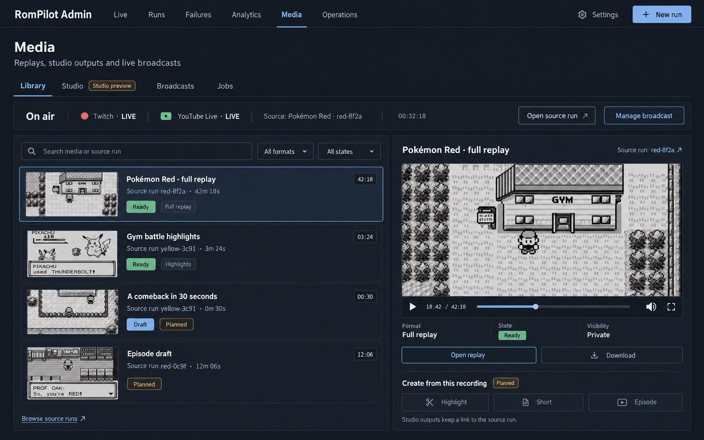
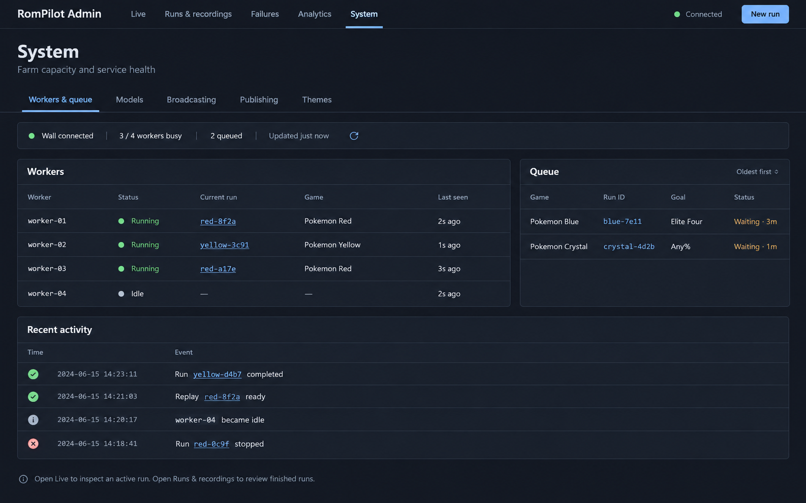
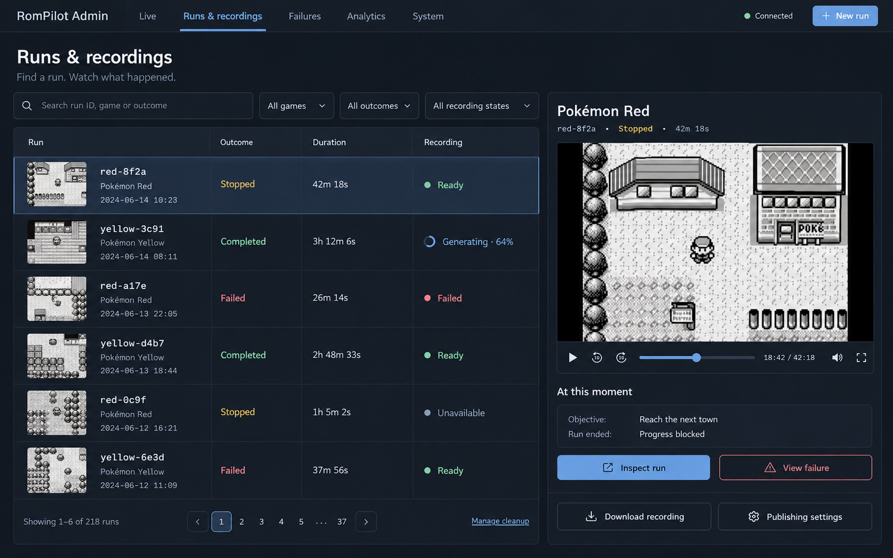

# Admin UI: clear task ownership and a connected Media workspace

Status: direction agreed with the operator on 2026-10-14; implementation is future work.
This document preserves the conversation and generated concepts so work can resume
without reconstructing the brief. Issue links are recorded at the end.

## Intent and success

The operator likes the live game view. Other admin screens feel crowded,
inconsistent, and overlapping; recordings are difficult to find. Preserve Live
as the visual and interaction anchor, give each task a predictable home, and
connect gameplay, run history, media production, and experiment results.

Media must remain a separate top-level workspace. It is more than replay
visibility: full replays, highlights, future Shorts/episodes, studio production,
publishing, and Twitch/YouTube Live broadcasting belong in one connected interface.
Model deployments are configuration. Experiments are comparisons with a creation
flow and results, not fleet administration. Tools currently means New run and
does not warrant a navigation destination.

Success means an operator can find a past recording, inspect its source run,
identify which platforms are broadcasting, launch a run or comparison, and
check capacity without visiting several competing copies of the same data.

## Navigation and ownership

| Destination | Owns | Links outward to |
| --- | --- | --- |
| Live | Selected active run, game, semantic map/state, objectives, decisions, run controls | Source run detail, Media for this run, broadcast setup |
| Runs | Searchable run history, outcomes, evidence, finished-run inspection and scoped cleanup | Live for an active run, recordings and studio outputs in Media, Failures, experiment |
| Failures | Failure groups, investigation, evidence, linked issues, resolved history | Exact source runs and corresponding media |
| Analytics | Aggregate outcomes, progress, model performance; Experiments section for creation, tracking and results | Experiment member runs, model Settings |
| Media | Library, Studio, Broadcasts and Jobs | Source run inspection, relevant configuration |
| Operations | Worker health, capacity, queues, leases and operational errors | Active run in Live, queued run details, model Settings |
| Settings | Model deployments, run defaults, destination configuration and renderer/theme configuration | Relevant operational workspace |

Primary navigation: Live, Runs, Failures, Analytics, Media, Operations.
Settings is a persistent utility entry. New run is a global action opening the
existing launch flow as a dedicated addressable page; it is not a primary tab.
No need to force the existing full form into a small modal.

## Shared composition and visual system

Use the existing Live screen and DESIGN.md as incumbent visual truth: a dark
workstation, game pixels as the strongest imagery, fitted panels, thin boundaries,
compact sans typography, monospaced IDs/timestamps, restrained semantic color.
Use common page headers, filters, secondary navigation, controls and resource
states. Avoid explanatory panels above actual work and interchangeable card grids.

Preserve useful density. Lists and tables should expose the minimum fields for
the task; detailed configuration and raw evidence open on demand. Keep status
text alongside color. One primary action per task area, explicit destructive
confirmation, visible keyboard focus, readable contrast and reduced motion.

## Live and Runs

Live remains the active gameplay workspace; no redesign of its game/map layout
is required by this project. Add contextual links without crowding its controls.

Runs owns run facts: game, goal, outcome, progress, timing, model identity, and
failure/evidence links. Search, filters, sort, pagination and inspection precede
cleanup. Keep existing archive capabilities and server-side filtering. Move
leaderboard/comparison content to Analytics rather than duplicating it in Runs.

Each row may summarize recording availability and provide Watch replay/Open Media.
Playback shortcuts are allowed, but the library and media-management controls
have one owner in Media. A finished run opens an honest historical inspector;
never imply live telemetry exists for an arbitrary historical video frame.

## Media

### Library

Browse media outputs with search and format/state filters. Select an output to
preview/play it and inspect its duration, availability and publication state.
Every item links to its source run. A run can have a full replay, highlights,
and eventually multiple Shorts or episodes; do not model these as separate runs.

Differentiate source recording availability, video generation state and public
visibility. Ready, queued, generating, failed, cancelled, unavailable and syncing
need explicit labels and useful actions. Missing prerequisites explain why an
action is unavailable. Retry applies to the affected output/job.

### Studio

Future home for source selection, editorial assessment, story beats, edit plans,
packaging, previews and publication review. Track this UI integration against
#796 and its existing children rather than recreating their backend scope.
Implement controls only when the corresponding capability exists; a concept
mockup does not authorize fake editors or nonfunctional creation buttons.

### Broadcasts

Choose a live source run and configured destination, preview what will be sent,
and deliberately start/stop output. Show Twitch and YouTube Live by name with
independent actual states: offline, starting, live, reconnecting, stopping, failed.
Use the states supplied by the backend; do not invent unsupported precision.

A running game, public spectator visibility, and outbound streaming are distinct
states. Never label a broadcast LIVE just because a game is running or a start
request was accepted. Display source run, destination, elapsed time and available
health/error information. Show links to the external channel when configured.

A compact on-air strip across Media makes active broadcasts discoverable while
browsing the library or jobs. Detailed control stays in Broadcasts. Configuration
lives in Settings with a link from the broadcast flow. Keep secrets server-side.

### Jobs and publishing

Jobs owns the media generation queue, stage/progress, errors and retry/cancel
controls. Open the exact job from an output or run instead of sending the operator
to a generic default tab. Publication status/actions belong beside the output;
future quality-gated publication review integrates #803. Library/Studio can link
to the relevant jobs without repeating the job-management UI.

## Analytics and Experiments

Use Analytics secondary sections for Overview and Experiments. Experiments owns
comparison setup, history, in-progress pairs and results. Start paired experiment
is an action there; selecting a comparison keeps its configuration and result
context together. Existing normal-run creation remains the global New run flow.

Link each experiment arm to its run and each run to its experiment when durable
identity exists. Keep matched-seed/policy/concurrency requirements and backend
comparability rules intact. Model Settings registers deployments; experiment
setup selects them. Preserve paired and endless comparison distinctions rather
than conflating unrelated experiment identity schemes.

## Operations and Settings

Operations follows the accepted mockup: compact health/capacity strip, workers
table, queue/leases and concise operational activity. Remove the full active
attempt gameplay table and finished outcome archive. A worker's current run is a
link to Live. Operational activity may mention run completion for context, but
is not another searchable results/history screen.

Move LLMDeploymentsPanel to Settings. Move PairedExperimentPanel to Analytics /
Experiments. Destination and theme configuration also live in Settings, with
contextual entry points from Media. Preserve all existing configuration behavior.

## Navigation contracts and migration

All sections must be addressable and reloadable. Preserve selected run ID,
media/output/job ID and experiment ID when navigating between their owners.
Use browser back/forward and reload without dropping context. Existing hash and
query deep links need compatible aliases: #tools opens New run, #media remains
Media, #operations remains Operations. Old links aimed at media jobs must resolve
to Jobs and select the relevant job/run. Avoid resetting a nested tab to its
default on every visit. Do not introduce a second authoritative data store for
navigation; reuse current APIs and durable IDs.

Loading, refreshing/stale data, empty results, API failure, vanished run/output,
unsupported media and unavailable configuration all need explicit recoverable
states. Narrow layouts stack the list and detail pane; navigation remains
reachable and controls do not overlap. Keep public spectator bundles and private
operator capabilities separate.

## Existing capability boundaries

Reuse run.gbrun as the canonical deterministic recording and generated media as
derivatives. No second capture pipeline. Source gameplay success and benchmark
results remain independent of rendering, studio and publishing failures.

Existing work: #172 owns replay/broadcast infrastructure; #178 owns completed
YouTube uploads; #179 delivered event-driven highlights. #796 owns editorial
studio; #797 producer/story, #799 edit plans, #800 live commentary, #801 metadata,
#802 thumbnails, #803 publication queue. #804 owns challenge/run scheduling.
The UI issues below integrate these capabilities and do not duplicate them.
Backend availability must be checked again at implementation time.

## Concepts and their authority

The Media concept reflects the agreed separate Media workspace. Shorts and
Episodes are future capabilities; sample data, game art and output states are
illustrative. Its Studio preview/Planned badges explain the design image, not a
requirement to ship placeholder controls.

Use this composition for Operations. Its earlier System label and Broadcasting /
Publishing tabs are superseded: those flows now live in Media and Settings.
Recent activity should describe operational events and link to their owners.

This earlier combined Runs & recordings concept established discovery and playback
adjacency. Its navigation/ownership is superseded by the table above: Runs owns
history; Media owns outputs. The final agreed structure wins over image text.

## Delivery and validation

Ship small PRs: shell/navigation first, then Operations/Settings and Experiments,
then Runs and Media integrations. Keep runtime/gameplay behavior outside scope.
Each implementation issue must link this design and its dependencies.

UI acceptance: desktop and narrow browser inspection, keyboard navigation,
loading/empty/error/stale states, deep-link reload and back/forward, cross-links
preserving exact IDs, rendering failure vs gameplay outcome, and actual outbound
broadcast status. Capture before/after screenshots. Run frontend behavior tests,
typecheck and operator build; preserve public build isolation. Repository floor:
gofmt for changed Go, go vet ./..., POKEMON_RED_ROM= go test -short -count=1 ./...;
add race checks if shared state changes. Report environmental failures honestly.

## Resume instructions

Read this design, PRODUCT.md and DESIGN.md; inspect current main and capability
APIs before implementing. Keep the existing Live layout. Start from the shell
issue, retain compatibility deep links, and implement one linked issue per PR.
Do not interpret this design-only PR as completing the UI epic or studio backend.

## Tracked work

Epic: #2670 ([GitHub](https://github.com/maestroi/PokePilot/issues/2670)).

- #2671: [docs: preserve agreed admin UI design, mockups and implementation issue map](https://github.com/maestroi/PokePilot/issues/2671)
- #2672: [admin UI: clarify navigation, global New run and persistent contextual links](https://github.com/maestroi/PokePilot/issues/2672)
- #2673: [admin UI: focus Operations on capacity and move configuration into Settings](https://github.com/maestroi/PokePilot/issues/2673)
- #2674: [admin UI: unite experiment creation, progress and results under Analytics](https://github.com/maestroi/PokePilot/issues/2674)
- #2675: [admin UI: make run history easy to scan and link recordings to their Media workspace](https://github.com/maestroi/PokePilot/issues/2675)
- #2676: [admin UI: connect Media Library, Studio, Broadcasts and Jobs around source runs](https://github.com/maestroi/PokePilot/issues/2676)
